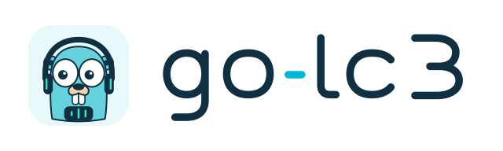

<p align="center">
  
</p>

A pure Go implementation of the **LC3 and LC3plus audio codecs**, adapted from
[Google's liblc3](https://github.com/google/liblc3).

The codec runs with `CGO_ENABLED=0`. It has no runtime dependencies, native
libraries, subprocesses, or platform-specific assembly.

## Features

- Encoding and decoding with persistent per-channel stream state.
- 8, 16, 24, 32, and 48 kHz LC3 sampling rates.
- 2.5, 5, 7.5, and 10 ms frames; 2.5 and 5 ms are LC3plus extensions.
- LC3plus high-resolution mode at 48 and 96 kHz with 2.5, 5, and 10 ms frames.
- A per-frame byte budget that can change during a stream.
- Internal encoder downsampling and decoder upsampling between supported rates.
- Packet-loss concealment for missing or corrupt frames.
- Signed 16-bit, signed 24-bit, packed 24-bit little-endian, and float32 PCM.
- Strided PCM for interleaved multichannel audio, using one codec per channel.
- The reference tools' `.lc3` file container and WAV command-line tools.

This is an independent port of liblc3 revision
[`48bbd3e`](https://github.com/google/liblc3/commit/48bbd3eacd36e99a57317a0a4867002e0b09e183).
The project targets that version's codec feature set. Compatibility is validated
against its scalar C implementation with a fixed floating-point profile;
this project does not inherit the upstream implementation's Bluetooth
qualification or claim independent standards certification.

## Install

Requires Go 1.23 or later.

```sh
go get github.com/0xbytejay/go-lc3
```

## Optional ARM64 NEON backend

On ARM64 with Go 1.27 or later, an experimental SIMD backend can be enabled:

```sh
GOEXPERIMENT=simd CGO_ENABLED=0 go test ./...
GOEXPERIMENT=simd CGO_ENABLED=0 go build ./...
```

It uses Go's `simd/archsimd` intrinsics and requires no C library, cgo, or
handwritten assembly. The SIMD API is experimental and requires opting in at
build time. Normal builds, older Go versions, and other architectures retain
the scalar backend. The `purego` build tag forces the scalar backend even when
the SIMD experiment is enabled.

The optimized kernels preserve the same scalar-reference numerical profile:
independent float32 operations remain separate, without introducing fused
multiply-add or changing floating-point accumulation order. NEON support does
not imply matching the upstream FMA-based NEON path's rounding. See
[VALIDATION.md](VALIDATION.md) for the compatibility contract.

## Encode and decode a frame

```go
package main

import (
    "log"
    "time"

    lc3 "github.com/0xbytejay/go-lc3"
)

func main() {
    cfg := lc3.Config{
        SampleRate:    16000,
        FrameDuration: 10 * time.Millisecond,
    }
    enc, err := lc3.NewEncoder(cfg)
    if err != nil { log.Fatal(err) }
    dec, err := lc3.NewDecoder(cfg)
    if err != nil { log.Fatal(err) }
    nbytes, err := cfg.FrameBytes(32000)
    if err != nil { log.Fatal(err) }

    input := make([]int16, enc.FrameSamples()) // 160 samples; fill with PCM
    frame := make([]byte, nbytes)             // 40 compressed bytes
    output := make([]int16, dec.FrameSamples())

    if err := enc.Encode(frame, input); err != nil { log.Fatal(err) }
    concealed, err := dec.Decode(output, frame)
    if err != nil { log.Fatal(err) }
    log.Printf("samples=%d concealed=%v", len(output), concealed)

    // A missing packet advances synthesis state using concealment.
    if _, err := dec.Decode(output, nil); err != nil { log.Fatal(err) }
}
```

Create a codec once and reuse it for consecutive frames. Each instance represents
one channel and must not be copied or used concurrently. `Reset` starts a new stream
without replacing the allocated buffers. Frame methods use caller-provided
buffers; extra PCM samples are ignored.

`Config.FrameSamples` and `DelaySamples` refer to the PCM sample rate.
`PCMSampleRate` defaults to `SampleRate`; when specified, it must be a supported
rate at least as high as the compressed stream's rate. Set `HighResolution` to
select the high-resolution rate family.

There is no native 44.1 kHz mode or general-purpose resampler. As with liblc3,
an application can supply 44.1 kHz samples to a nominal 48 kHz configuration,
but the effective frame duration and audio bandwidth then scale accordingly.

## PCM and multichannel audio

`Encode` and `Decode` are the mono signed 16-bit convenience methods. The typed
`EncodeS16`, `EncodeS24`, `EncodeS24LE`, `EncodeFloat32` methods and their decoder
counterparts accept a sample stride. For stereo, use independent left/right
instances, slice the PCM buffer at each channel, and set stride to 2.

`EncodePCM` and `DecodePCM` accept little-endian byte buffers plus a `PCMFormat`.
S24 words are sign-extended 32-bit integers; S24LE samples occupy three bytes.
Float32 PCM must be finite and within `[-1, 1]` when encoding. Invalid parameters
return an error before advancing codec state.

Decoder packet loss is separate from parameter errors: `nil` or corrupt data
produces a concealed frame and returns `concealed=true, err=nil`. An invalid
buffer size returns an error. An empty, non-nil frame is an invalid frame size.

## Command-line tools

```sh
go install github.com/0xbytejay/go-lc3/cmd/elc3@latest
go install github.com/0xbytejay/go-lc3/cmd/dlc3@latest

elc3 -b 32000 -m 10 input.wav output.lc3
dlc3 input.lc3 output.wav
```

Use `-h` for options. The encoder reads signed 16-bit and 24-bit PCM WAV files;
the decoder writes 16-bit PCM by default or 24-bit PCM with `-b 24`. The core
library supports all four PCM formats. The `.lc3` container is the
**non-standard reference-tool format**, not a Bluetooth transport or a
standardized media container. The `lc3file` package reads and writes its header and frame blocks.

For finite files, the encoder zero-pads the final input and flushes its delay;
the decoder trims initial delay and respects the original sample count. Raw
frame APIs deliberately leave transport framing and delay trimming to callers.
Named output files are replaced only after successful conversion; failures
preserve existing files. Standard output streams can be partial on error.

## Testing and development

```sh
CGO_ENABLED=0 go test ./...
go test -race ./...
go vet ./...
go test -run '^$' -bench . -benchmem ./...
```

Checked-in deterministic fixtures compare codec results to the pinned upstream
source. Ordinary tests need only Go; C and Python are optional development tools
for regenerating fixtures. See [VALIDATION.md](VALIDATION.md) for the numeric
profile, coverage, reproduction commands, and compatibility boundaries.

The implementation retains upstream scalar operation order and explicit
binary32 rounding, including PCM conversion and fast-math approximations. It
does not promise bit-for-bit equality with every compiler option or upstream
SIMD path, which can produce different floating-point rounding.

## License

[Apache License 2.0](LICENSE) for the codec source. See [NOTICE](NOTICE) for
upstream attribution.

Logo artwork: [CC BY 4.0](https://creativecommons.org/licenses/by/4.0/).

Contributions and reproducible bug reports are welcome. Please include the
configuration, frame sequence, expected behavior, and a minimal synthetic input.
See [CONTRIBUTING.md](CONTRIBUTING.md).
